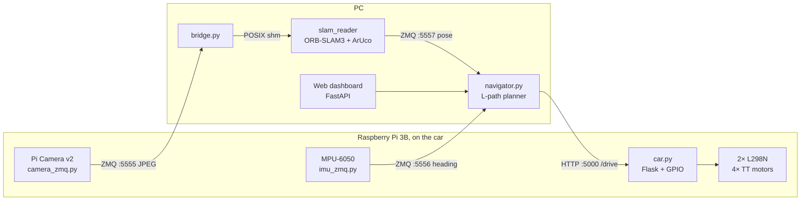

<picture>
  <source media="(prefers-color-scheme: dark)" srcset="docs/media/banner-dark.svg">
  
</picture>

# Monocular SLAM Navigation

An indoor autonomous RC car that drove between calibrated stations using only one camera and an IMU, with no lidar, wheel encoders or depth sensor. Raspberry Pi 3B on the car, ORB-SLAM3 on a PC, and my own C++ changes to ORB-SLAM3 for ArUco relocalization.

<table>
<tr>
<td><br/>
<sub>Real run to Station 1 (3× speed). The pauses come from the low number of visual features in the room.</sub></td>
<td><br/>
<sub>Real run to Station 1 in good lighting, shown on the web dashboard.</sub></td>
</tr>
</table>

## Overview

The goal was indoor navigation with the cheapest possible sensors: a Pi Camera v2 and an MPU-6050. The Raspberry Pi 3B streamed camera frames and IMU heading to a PC over ZeroMQ. The PC ran ORB-SLAM3 for position, planned an L-shaped path to the chosen station, and sent motor commands back to the Pi over HTTP. When SLAM lost tracking on plain walls, wall-mounted ArUco markers gave the car its absolute pose again.

The car was built and tested on real hardware. It is no longer available, so the repo now also has a test mode that runs the navigator and dashboard without any hardware.

## What I built vs reused

**Built (solo):**
- The full navigation stack: L-path planner, stall detection, post-spin SLAM settle logic, and station calibration tools (`navigation/`).
- The Pi services: motor controller, IMU publisher with zero-velocity update, camera streamer (`pi/`).
- The ZeroMQ pipeline between Pi and PC, and the POSIX shared-memory bridge into the SLAM process (`slam/bridge.py`, `slam/slam_reader.cc`).
- Changes to ORB-SLAM3 in C++. Read them in [`slam/orbslam3.patch`](slam/orbslam3.patch); the reasons are in [`slam/CHANGES.md`](slam/CHANGES.md):
  - a new `System::InjectPoseHint(const Sophus::SE3f& Tcw)` API that restarts tracking from a known pose;
  - ArUco marker detection and PnP pose for relocalization;
  - a fix for a crash when saving the atlas (`Map::PreSave` erased elements while iterating);
  - a fix so relocalization works after loading a saved atlas (`KeyFrameDatabase::DetectRelocalizationCandidates`).
- The web dashboard (FastAPI). The telemetry stack moved to [robot-telemetry-monitoring](https://github.com/LakhdariAnis/robot-telemetry-monitoring).

**Reused:**
- [ORB-SLAM3](https://github.com/UZ-SLAMLab/ORB_SLAM3) (GPLv3), included as a Git submodule.
- OpenCV (ArUco module), ZeroMQ, FastAPI, Flask, NumPy, SciPy.

## Architecture



SLAM ran on the PC because ORB-SLAM3 needs about 800 MB of RAM at runtime and the Pi 3B has 1 GB. All ZeroMQ subscribers use `CONFLATE=1`, so only the newest message is kept and queues never build up when SLAM slows down.

## Hardware

| Component | Role |
|---|---|
| Raspberry Pi 3B (1 GB RAM) | Sensor streaming and motor control |
| Pi Camera v2 (640×480, JPEG quality 80) | The only position sensor, through SLAM |
| MPU-6050 IMU (I²C, 50 Hz) | Heading during spins |
| 2× L298N H-bridge, 4× TT motors | Drive |
| ArUco markers (DICT_4X4_50, 18.4 cm), printed and wall-mounted | Absolute pose when SLAM is lost |
| PC | Runs ORB-SLAM3 and the navigator |

## Engineering problems I solved

- **SLAM lost tracking while spinning.** Motion blur at higher motor power made ORB-SLAM3 lose tracking. In tuning, 60% PWM made the pose jump by 0.5 m or more. The navigator spins at 40% PWM (`SPIN_SPEED = 40`). See [`docs/SPIN_PROTOCOL.md`](docs/SPIN_PROTOCOL.md).
- **Stale poses after a spin.** Every spin is followed by two fixed holds (`POST_SPIN_HOLD_SECS = 1.0`, `POST_SPIN_SLAM_WAIT = 0.5`) so SLAM can pick up features again before the car trusts its position.
- **Silent motor stalls on carpet.** A sliding window on the SLAM position (less than 2 mm progress per step) detects no movement. After 80 zero-progress steps (about 8 s) the car reverses and retries.
- **Slow relocalization on plain walls.** Upstream relocalization can take seconds or fail. ArUco PnP gives the camera pose, and `InjectPoseHint` restarts tracking from it.
- **IMU drift.** Heading is gyro-integrated, with a zero-velocity update that freezes integration when the car is still. Spins never last more than 5 s, which keeps drift small.

## Getting started

### Test mode (no hardware)

```bash
git clone https://github.com/LakhdariAnis/monocular-slam-navigation.git
cd monocular-slam-navigation
pip install fastapi uvicorn pyzmq scipy numpy opencv-python requests
python3 -m navigation.web.server --mode test
```

Open http://localhost:8080, pick a station and click **GO**. The dashboard animates the L-path and the mock position.

### Real hardware (for reference)

1. On the Pi, start the three services (see [`pi/README.md`](pi/README.md)): `python3 car.py`, `python3 imu_zmq.py`, `python3 camera_zmq.py`.
2. On the PC, copy my changed files over the submodule (`cp -r slam/orbslam3/* ORB_SLAM3/`), build ORB-SLAM3 and `slam_reader` (see [`slam/README.md`](slam/README.md)), then run it in localization mode: `./slam_reader ORBvoc.txt picam.yaml --loc room_map`.
3. Start the navigator in real mode and pick a station from the dashboard.

## Monitoring

The telemetry and anomaly-detection stack I built for this car (MQTT, InfluxDB, a rule-based detector and a live dashboard) now lives in its own repo: [robot-telemetry-monitoring](https://github.com/LakhdariAnis/robot-telemetry-monitoring). It was tested on a car simulator and never connected to the real car.

## Repository structure

```
navigation/   L-path navigator, web dashboard, calibration tools, stations.json
slam/         slam_reader (C++), shared-memory bridge, map builder, my ORB-SLAM3 changes (patch + files)
pi/           Motor controller (Flask/GPIO), IMU publisher, camera streamer
data/         Calibration, map points, marker positions, camera settings
docs/         Spin protocol, project report, demo media
ORB_SLAM3/    Upstream ORB-SLAM3 (Git submodule)
```

## Limitations

- The car is no longer available, so the code can't be tested on hardware anymore.
- There are no measured accuracy numbers (position error, success rate). The demos show working runs only.
- SLAM ran on a PC, not on the Pi.
- A complementary filter (`ALPHA = 0.98`) is defined in `pi/imu_zmq.py` but not used in the heading update.

## Context

Solo 2CS end-of-year project at École Supérieure en Informatique, Sidi Bel Abbès (Algeria), academic year 2025/2026. Supervised by Abdelatif Rahmoun and Hamdane Bensenane. The full report is in [`docs/`](docs/).

Author: Anis Charaf Eddine Lakhdari.

## License

ORB-SLAM3 is licensed under GPLv3, so this project is released under GPLv3 too. Thanks to the ORB-SLAM3 authors at the University of Zaragoza.
